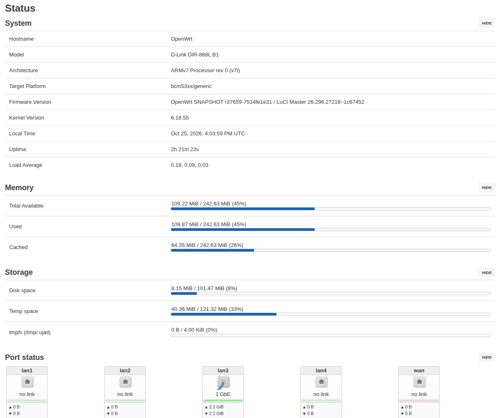
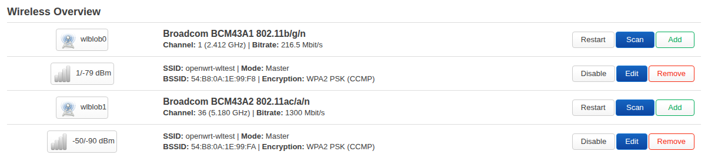

# OpenWrt for the D-Link DIR-868L B1, with WiFi

Builds an OpenWrt image for the DIR-868L B1 (BCM47081 + BCM4360 5 GHz + BCM4331 2.4 GHz) in which
both radios work: AP (one or more SSIDs), station mode, WPA2-PSK, LuCI status.  The in-kernel
`b43` driver cannot drive these radios; this uses Broadcom's proprietary `wl` core, re-linked
against the current kernel, with the surrounding userland built from the FreshTomato GPL sources.

Nothing proprietary is stored in this repository.  At build time the driver core (`wl_apsta.o`,
wl 6.37.14.126) and the `wl` control tool are downloaded from the public FreshTomato ARM source
tree at a pinned commit and verified by sha256.





## Performance

Measured on 2026-10-25 with the **v0.3.1 driver package**, OpenWrt r37659 / Linux 6.18.55,
and a GL-MT6000 client about two metres away. Each value is the mean of two 12-second TCP
`iperf3` runs, with one band tested at a time and the server on the DIR-868L. Default packet
optimizations are enabled; TX A-MSDU is off and A-MPDU is on.

| Band | Mode | TCP streams | Client → router | Router → client |
|---|---|---:|---:|---:|
| 5 GHz | VHT80, channel 36 | 1 | 321 Mbit/s | 256 Mbit/s |
| 5 GHz | VHT80, channel 36 | 4 | 341 Mbit/s | 258 Mbit/s |
| 2.4 GHz | HT20, channel 1 | 1 | 53 Mbit/s | 109 Mbit/s |
| 2.4 GHz | HT20, channel 1 | 4 | 60 Mbit/s | 107 Mbit/s |

Router CPU at a fixed offered rate, comparing the packet-processing options off/on
in the same package (two 12-second runs per setting, off/on/on/off):

| Traffic path | Offered rate | CPU, options off | CPU, options on |
|---|---:|---:|---:|
| Wi-Fi → router | 200 Mbit/s | 67.4% | 60.8% |
| Router → Wi-Fi | 150 Mbit/s | 62.4% | 59.7% |
| Wi-Fi → Ethernet bridge | 80 Mbit/s | 36.4% | 37.1% |
| Ethernet → Wi-Fi bridge | 80 Mbit/s | 60.1% | 56.3% |

The throughput table measures direct Wi-Fi endpoints; the bridge rows measure CPU at
80 Mbit/s below the wired path's 100 Mbit/s bottleneck. NAT was not measured. Results depend
on the client and radio conditions. Test details, retransmissions and UDP observations are
in the [v0.3.1 validation report](docs/releases/v0.3.1-validation.md); earlier measurements
and experiments are in [Performance and driver research](docs/PERFORMANCE.md).

## Download and install

Ready-made images are on the [Releases](https://github.com/LTe/openwrt-dir868l-b1/releases) page:
`openwrt-bcm53xx-generic-dlink_dir-868l-b1-squashfs.bin` plus its `sha256sums` and the package
manifest.  The image includes LuCI (HTTP and HTTPS) and the WiFi stack for both radios.  One file
serves every path below: it is a SEAMA container the D-Link bootloader and web UI accept, and on
OpenWrt it is the `sysupgrade` image.

### From the stock D-Link firmware

1. Connect a PC by cable to a LAN port and log in to http://192.168.0.1.
2. Tools → Firmware → Upload, select the `.bin`, start the upgrade.
3. Wait about 3 minutes; do not power the router off.  It reboots into OpenWrt.

### Recovery mode (from any firmware, also to go back to stock)

1. Power the router off.  Hold the Reset button, power on, keep holding until the power LED
   starts blinking (about 10 s), then release.
2. Give the PC a static address such as 192.168.0.2/24 and open http://192.168.0.1: a plain
   upload page served by the bootloader.
3. Upload the `.bin` (or D-Link's stock `DIR868LB1_FW*.bin` to revert) and wait for the reboot.

### From OpenWrt

LuCI: System → Backup / Flash Firmware → Flash image.  Shell:

    sysupgrade -n openwrt-bcm53xx-generic-dlink_dir-868l-b1-squashfs.bin

Keeping settings is fine between releases of this repository; use `-n` (or untick "Keep settings")
when coming from a different OpenWrt build.

### First boot

- LAN: http://192.168.1.1 (also https://), user `root`, no password; set one in System → Administration.
- WiFi: both radios appear in Network → Wireless (`wlblob0` = 2.4 GHz, `wlblob1` = 5 GHz) and are
  disabled; set an SSID and WPA2 key and enable them.  See "Using the WiFi" below.

## Layout

| path | what |
|---|---|
| `openwrt/` | upstream OpenWrt, git submodule pinned to a commit |
| `patches/` | applied on top of it: DIR-868L B1 device support (PR openwrt/openwrt#20684), a netifd fix, iwinfo `wl` backend |
| `feed/` | an OpenWrt package feed: `kmod-brcm-wl-blob` (driver), `brcm-wl-tools` (nas, eapd, wlconf, wl, libnvram), `wlblob-utils` (netifd integration) |
| `config.seed` | the `.config` delta: target, device, these packages, LuCI |
| `Makefile` | glue: submodule, patches, feed, config, build, copy images to `out/` |
| `.github/workflows/build.yml` | CI: same steps in upstream's build container with the prebuilt toolchain; publishes releases |

## Build

Needs the usual [OpenWrt build prerequisites](https://openwrt.org/docs/guide-developer/toolchain/install-buildsystem).

    make            # first build compiles the toolchain too; count on an hour or more
    ls out/         # openwrt-bcm53xx-generic-dlink_dir-868l-b1-squashfs.bin + manifest + sha256sums

The image is a SEAMA container: the stock D-Link web UI accepts it as a firmware update, and on
OpenWrt it is the `sysupgrade` image.

Useful knobs: `make menuconfig` then `make image`; `make saveconfig` to persist the config delta;
`V=s` for a verbose build; `TOOLCHAIN_DIR=$(scripts/get-toolchain.sh)` to use OpenWrt's prebuilt
toolchain instead of building one.

### Updating OpenWrt

    git -C openwrt fetch origin && git -C openwrt checkout origin/main
    make prepare    # patches must still apply; drop patches/0001 once the device PR is merged
    make image
    git add openwrt && git commit -m "openwrt: bump"

## Releases

- Pushing a tag `v*` builds that commit in CI and publishes a release with the image attached.
- Every Monday CI compares the pinned `openwrt` commit with upstream `main`.  If upstream moved,
  it bumps the submodule, builds, and when the build succeeds commits the bump to `main` and
  publishes a release tagged `openwrt-rNNNNN-<hash>` (the OpenWrt snapshot version).  A failed
  build (patches that no longer apply, a kernel bump the driver glue does not handle yet) changes
  nothing and shows up as a failed run.  The same can be started by hand: Actions → Build firmware
  → Run workflow with "Bump" ticked.

## Using the WiFi

The radios appear as ordinary `/etc/config/wireless` devices of type `broadcom` (`wl0` = 2.4 GHz,
`wl1` = 5 GHz), created by `wifi config`.  Supported: `mode ap` (several per radio), `mode sta`,
`encryption none|psk|psk2|psk-mixed`, `channel`, `htmode` (HT20/40, VHT20/40/80), `hidden`,
`isolate`, `maxassoc`, `txpower`, `country`.  Not supported: WPA3, 802.11r, mesh, monitor.

Starting with v0.3.1, the FreshTomato driver enables supported IPv4 TCP checksum offload,
selective TCP GRO, RX/TX batching and TX buffer reuse by default. The optional per-radio
`amsdu` setting controls TX A-MSDU. To use the 5 GHz aggregation setting from the table:

```sh
uci set wireless.wlblob1.amsdu='0'
uci commit wireless
wifi reload
```

Under the hood: `kmod-brcm-wl-blob` exposes `wlN` netdevs and an emulated `/dev/nvram`;
`/lib/netifd/wireless/broadcom.sh` configures the radio through `wl` and writes the `wlN_*` nvram
variables; `eapd` and `nas` (authenticator for APs, supplicant for stations) do WPA.  Radio
calibration data comes from the stock firmware's NVRAM defaults (`/usr/share/wlblob/wl-nvram.tmpl`)
plus the MAC addresses from the `devdata` partition.

## Development documentation

Driver measurements and experimental work are documented in [Performance and driver research](docs/PERFORMANCE.md).

## Checking that LuCI and netifd get what they need

LuCI's wireless page has no logic of its own: it shows what `iwinfo` reports (channels, modes,
signal, stations) and writes `/etc/config/wireless` for netifd.  `wlblob-check` (in
`wlblob-utils`) verifies that chain on the router:

    wlblob-check            # read-only: iwinfo answers, netifd status, driver state vs. config
    wlblob-check --config   # also applies every configuration LuCI can write (encryption
                            # variants, channel, htmode, hidden, missing band, WEP/ad-hoc which
                            # must be refused), radios restart repeatedly, config restored after

Lines start with PASS, FAIL or WARN (known gaps); the exit status is the number of failures.

## Driver core variants

`kmod-brcm-wl-blob` defaults to the FreshTomato core.  The D-Link stock core (wl 6.37.14.56, AP
only) can be used instead by passing `WLBLOB_VARIANT=dlink WLBLOB_DLINK_KO=/path/to/wl_ap.ko`
(extracted from the 2.03B01 firmware) to `make`.

## Credits

- [northstar-broadcom-revival](https://github.com/umair-gititall/northstar-broadcom-revival): the
  same idea for Northstar boards; its vendored nas/eapd/wlconf/libshared sources and the uClibc
  shim for `wl` are what `brcm-wl-tools` builds.
- FreshTomato for keeping the SDK 6.37 sources and binaries public.
